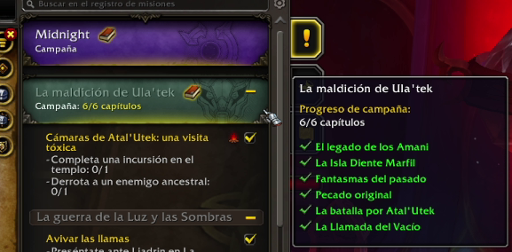
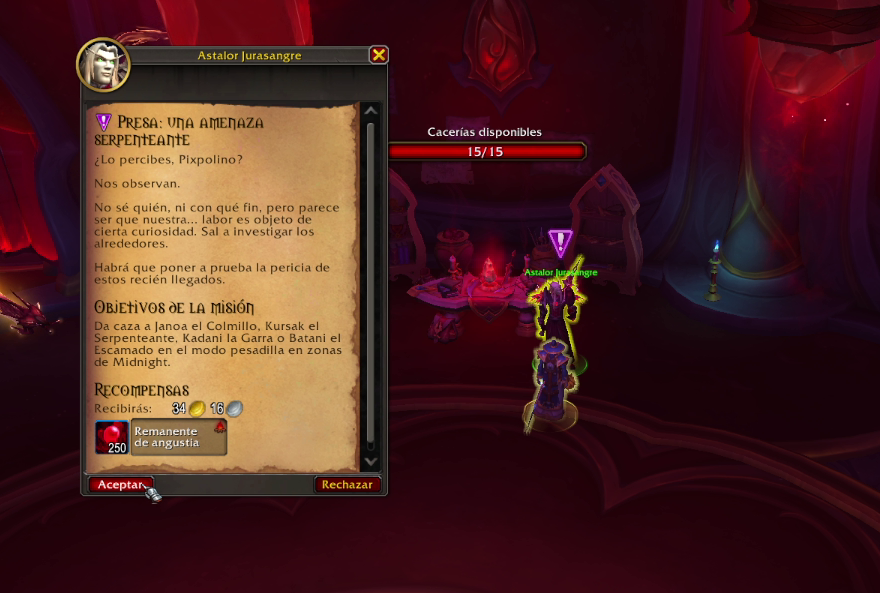
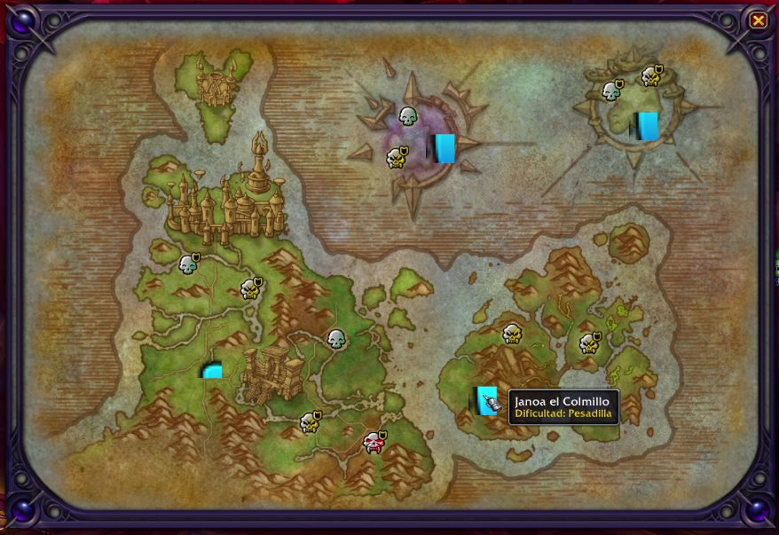
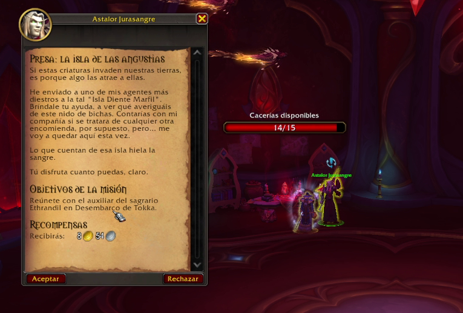
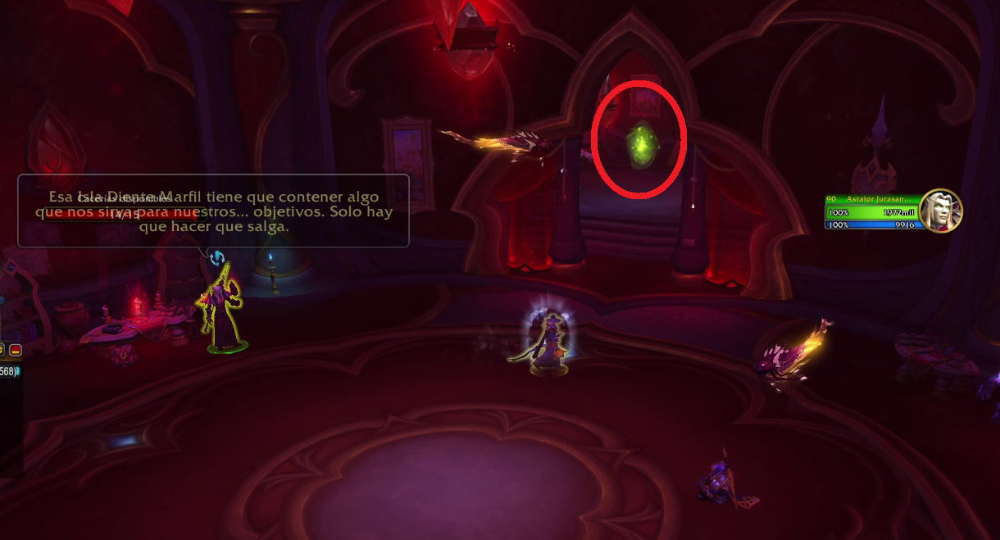
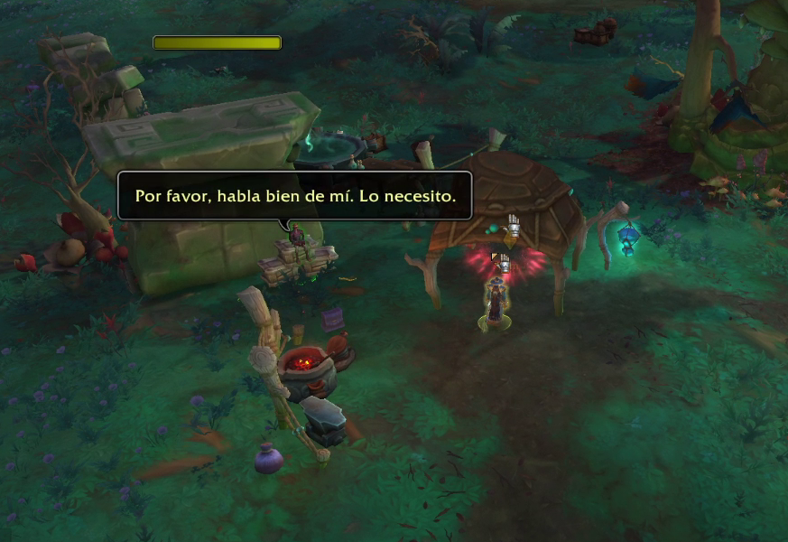
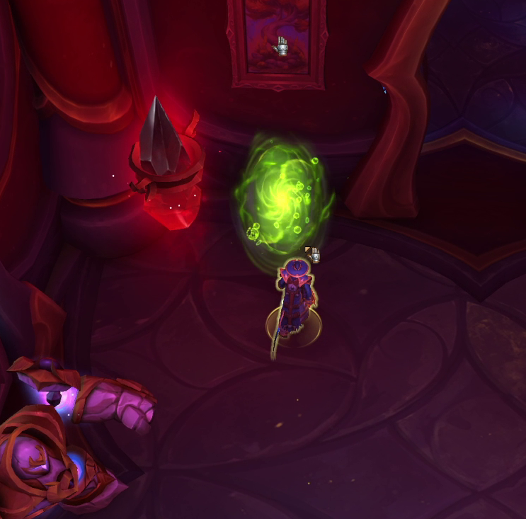

La llegada del parche 12.1 de World of Warcraft trae consigo una nueva zona que los jugadores podrán explorar: La Isla Serpenteante, una isla que encontramos al este de Zul'Aman. Aunque es posible llegar volando a esta nueva zona sin ningún problema, existe una forma de desbloquear un portal que nos permitirá viajar entre la Ciudad de Lunargenta y la zona del Desembarco de Tokka (base central de la Isla Serpenteante). Este portal solamente se podrá desbloquear con la Temporada 2 activa, ya que es necesario poder realizar cacerías en dificultad Pesadilla.

### Requisitos previos: campaña inicial

Para desbloquear el portal, lo primero que tenemos que tener es completo al menos los cuatro primeros capítulos de la campaña inicial del parche 12.1, ya que así tendremos desbloqueadas todas las zonas nuevas. Aún así, desde AlterTime os recomendamos completar todos los capítulos iniciales para aseguraros bien de que lo tenéis todo desbloqueado.

### Presa: Una amenaza serpenteante

Una vez tengamos esto completado, nuestro siguiente objetivo será ir hacia el Sagrario de Astalor en Lunargenta, que nos ofrecerá la misión **Presa: Una amenaza serpenteante**, una misión que nos pide completar un objetivo de Presa en dificultad Pesadilla en específico.

### Elegir la cacería en Pesadilla

Una vez aceptada la misión, accederemos al mapa para elegir cacerías. Aquí es importante elegir alguna de las que nos pide la misión, asegurándonos de que está en dificultad Pesadilla.

### Presa: La isla de las angustias

Una vez escogida la presa, debemos realizarla para completar la misión de Astalor. Una vez completada la misión, Astalor nos ofrecerá otra nueva misión: **Presa: la isla de las angustias**.

### El portal verde

Esta misión nos pide reunirnos con el auxiliar del sagrario Ethrandil en la zona del Desembarco de Tokka, en la Isla Serpenteante, una misión que al aceptarla ya nos abrirá un portal directo de color verde hacia la zona que se encuentra justo en el pasillo de la derecha.

### Portal de vuelta

Una vez atravesemos el portal nos encontraremos con nuestro objetivo al que entregaremos la misión para que nos ofrezca la siguiente. Una vez completada la siguiente misión, que simplemente nos pide interactuar con un objeto junto al NPC, se abrirá un portal de vuelta justo al lado.

### Portales abiertos

Al volver y entregar esta última misión a Astalor, ambos portales quedarán abiertos para poder utilizarlos y viajar rápidamente entre la Ciudad de Lunargenta y el Desembarco de Tokka en la Isla Serpenteante

