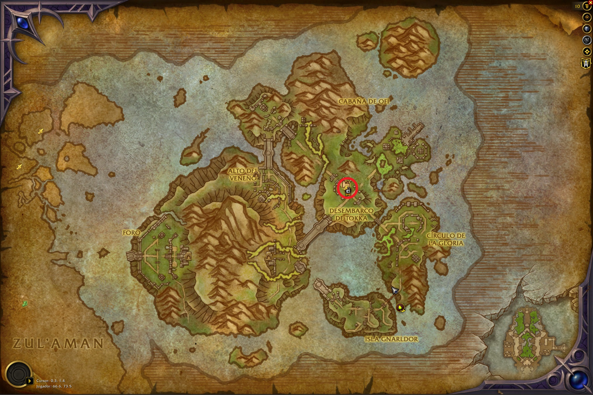
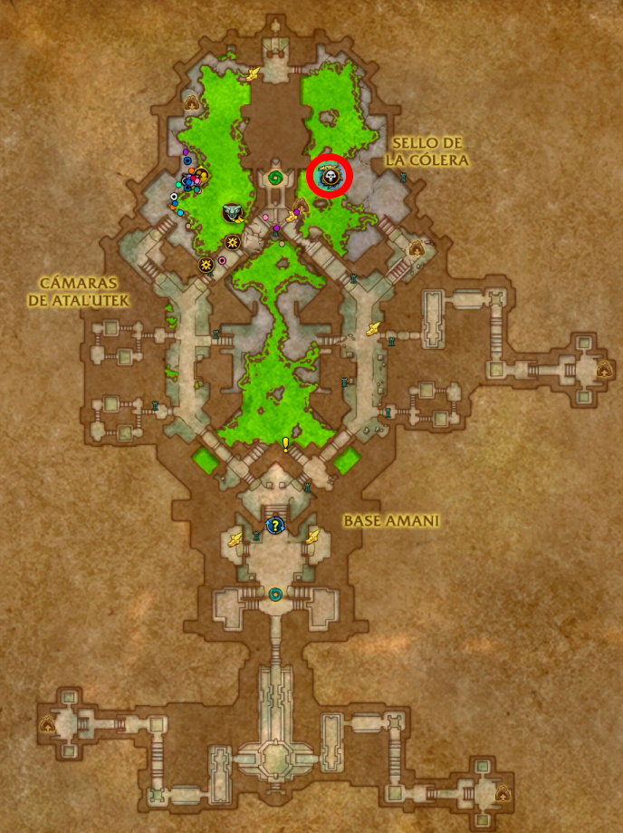
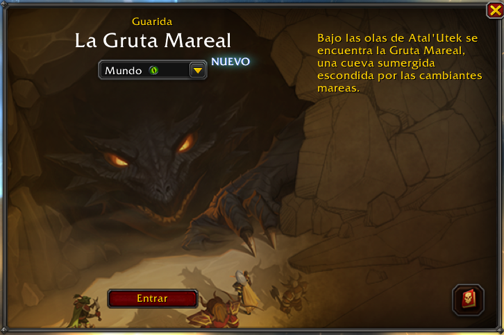
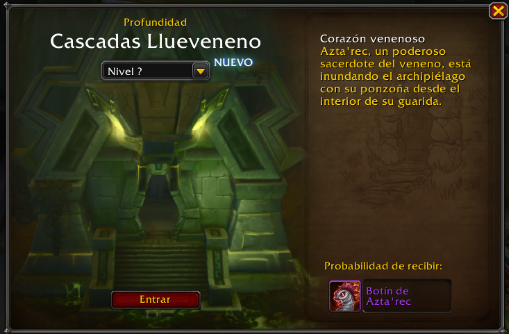

import WoWItem from '../../components/mdx/WoWItem.astro';

Si buscas maximizar y acumular todo el poder posible para tus personajes en la primera semana, el Códice corrosivo puede ser una de las mejores ayudas que pueden encontrar, especialmente si están planeando derrotar a la némesis en la primera semana de temporada y obtener la proeza de fuerza exclusiva, ya que al desbloquear por completo el códice, es posible activar dos poderes de forma simultanea.

Según se ha podido descubrir es posible obtener hasta 9x <WoWItem id="273000" /> con cada uno de nuestros personajes a nivel 90, teniendo en cuenta que cada poder requiere 8 de estas almas para ser desbloqueado, necesitamos 64x <WoWItem id="273000" /> para completarlo al 100%, lo cual significa que si tenemos 7 personajes a nivel 90, podremos desbloquearlo al completo. Para ello debemos realizar ciertas actividades con nuestros personajes:

### Misión semanal: Exterminio en las Cámaras

La misión semanal [Exterminio en las Cámaras](https://es.wowhead.com/quest=95520) nos pide realizar actividades en las Cámaras de Ata'Utek, una misión que se puede realizar en grupo sin ningún problema. Esta misión nos la entregará la [Comandante garfa Zela](https://es.wowhead.com/npc=267635) en la zona del Desembarco de Tokka, en la Isla Serpenteante. Al terminarla obtendremos entre todas las recompensas 2x <WoWItem id="273000" />.

### Misión semanal: Repeler la Oleada

Esta misión semanal nos pide acabar con 3 oleadas malditas (aparecen en la superficie de la Isla Serpenteante cada 45 minutos). Al igual que la misión anterior, esta también nos la entregará la [Comandante garfa Zela](https://es.wowhead.com/npc=267635) y al terminarla obtendremos 2x <WoWItem id="273000" />.

### Matar al jefe de las Cámaras de Atal'Utek

Como parte de los Asaltos e Incursiones al Templo de la zona de las Cámaras de Atal'Utek, esta actividad nos pedirá matar a un jefe. Al derrotarlo por primera vez con cada personaje obtendremos 1x <WoWItem id="273000" />

### Guarida

Una de las novedades de este parche 12.1 es el cambio de los jefes de mundo para incluirlos en una instancia llamada Guarida. Al derrotar a este jefe por primera vez con cada uno de nuestros personajes obtendremos 3x <WoWItem id="273000" /> independientemente de la dificultad.

### Derrotar a Azta'rec

Como parte de la primera semana del parche tenemos disponible el combate contra Azta'rec en dificultad «?». Al derrotarlo por primera vez con cada personaje obtendremos 2x <WoWItem id="273000" />.

Es importante tener en cuenta que las <WoWItem id="273000" /> están ligadas a banda guerrera por lo que podemos compartirlas entre nuestros personajes para acumularlas ya que una vez desbloqueemos uno de los poderes con un personaje, este se desbloqueará para toda nuestra cuenta.

### Otras fuentes

Además de lo anterior, es posible obtener mas almas corrosivas al realizar otras actividades como derrotar a rares en la Isla Serpenteante aunque la probabilidad de obtener un <WoWItem id="273000" /> de estos es muy baja por lo que no se incluyen entre las 10 almas aseguradas que podemos conseguir.

Es importante tener en cuenta que las <WoWItem id="273000" /> están ligadas a banda guerrera por lo que podemos compartirlas entre nuestros personajes para acumularlas ya que una vez desbloqueemos uno de los poderes con un personaje, este se desbloqueará para toda nuestra cuenta.